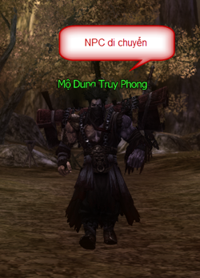
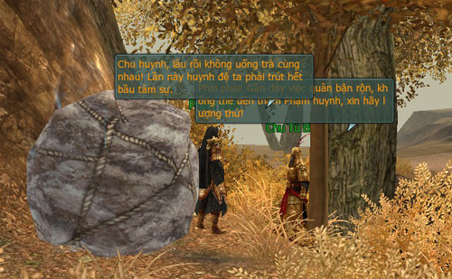

Bên cạnh vẻ đẹp kiếm hiệp chân thật cùng khả năng khinh công thỏa sức không giới hạn, Võ Lâm 3 còn sở hữu một hệ thống nhiệm vụ cực kỳ phong phú đa dạng và có chiều sâu, gắn liền với những nhân vật NPC mà quý nhân sĩ sẽ gặp trên hành trình bôn tẩu.

Những NPC nhiệm vụ này đôi lúc **không đứng yên tại tọa độ chỉ định** mà sẽ di chuyển khắp nơi, quý nhân sĩ sẽ phải di chuyển xung quanh khu vực đó để tìm được họ. Đây được gọi là **cuộc dạo chơi của NPC trong Võ Lâm 3**.

  
 *Mộ Dung Truy Phong - NPC thích "đi dạo" nhất Lạc Đạo*

Vì vậy, khi thực hiện nhiệm vụ, quý nhân sĩ **cần theo dõi yêu cầu và hướng dẫn thực hiện trong bảng thông tin chi tiết** nhiệm vụ (phím tắt **L**). Ngoài ra, sẽ có lúc chư vị cần phải khinh công lên đỉnh núi hoặc âm thầm theo dõi NPC, vận chân khí vẽ bùa hoặc ngụy trang thành tảng đá để nghe trộm bí mật của Thần Sách Quân...

  
 *Ngụy trang thành tảng đá để thu thập thông tin*

Hy vọng sự tương tác đa dạng trong nhiệm vụ sẽ làm thế giới kiếm hiệp tình duyên trong Võ Lâm 3 thêm phần hấp dẫn, thú vị và mang đến nhiều niềm vui cho quý nhân sĩ khi bôn tẩu giang hồ.

Nguồn: VNG (bài viết và hình ảnh)
